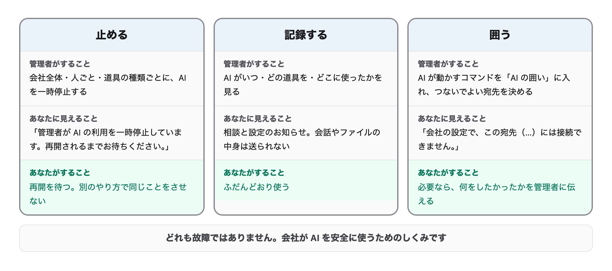
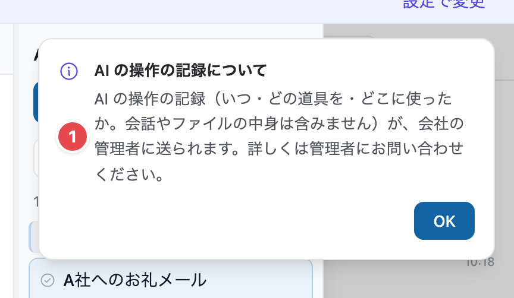
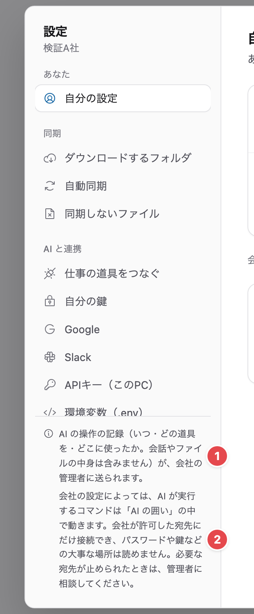
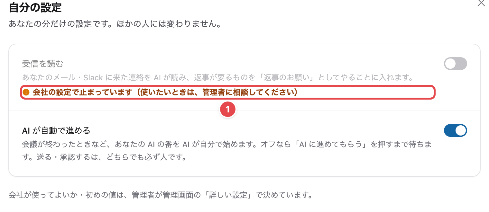
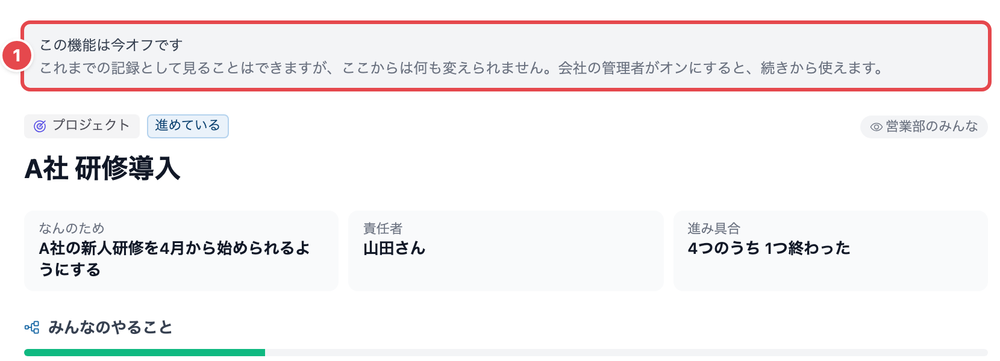

# 41章　AI が止まっている・記録されている・囲われているとき

## はじめに

前の章の最後に、こんな疑問が残りました。

「AI に頼んだら『管理者が AI の利用を一時停止しています』と出た。壊れたの？」

会社の PC で、ときどき「管理者によって制限されています」と出ることはありませんか？　社用のスマホは、会社が管理していますよね。それと同じで、会社は AI を安全に使うために、**AI を止める・AI がしたことを記録する・AI が動ける範囲を囲う** ことができます。

**どれも故障ではありません。** この章では、それぞれのときにあなたに見えるものと、あなたがすることを見ていきます。

> **会社によって出るものです**
>
> この章のことは、会社がそのしくみを使っているときだけ出ます。出ていなければ、読み飛ばしてかまいません。

### この章で分かること

- 「管理者が AI の利用を一時停止しています」と出たとき
- 「AI の操作の記録」で、管理者に何が送られるのか
- 「AI の囲い」で、つながらない宛先があったとき
- 自分の設定や記録が「会社の設定で止まっています」「この機能は今オフです」になっているとき

---

## 3つのしくみ

---

## AI が止まっているとき

管理者は、困ったことが起きたときなどに、AI を一時停止できます。会社全体のこともあれば、一人だけ、または道具の種類だけのこともあります。

**相談しようとすると**、相談の上に赤い帯が出て、「エラーが発生しました」に続けて **「管理者が AI の利用を一時停止しています。再開されるまでお待ちください。」** と書かれています。英語の記号が一緒に並ぶことがありますが、気にしなくてかまいません。

**AI が動いている途中で止まったとき**は、返事の最後に「※ 管理者が停止しました。」と出て、そこで終わります。

**道具の種類だけが止まっているとき**は、AI は相談を続けますが、止められた道具（コマンドの実行・ファイルの書き込み・Web へのアクセス・外部の道具）は使いません。AI が「管理者が『…』を一時停止しているため、実行していません」のように伝えてくれます。

止まっている間は、AI の番（21章）も進みません。再開されると、続きから進みます。

あなたがすることは、**再開を待つことだけ**です。止まっている作業を、別の AI や別のやり方で済ませようとしないでください。急ぐ仕事があるときは、管理者にそのことを伝えましょう。

---

## AI の操作が記録されているとき

会社によっては、AI がした操作の記録が、会社の管理者に送られます。はじめて相談を開いたときに、一度だけ、こんなお知らせが出ます。

①のとおり、送られるのは **「いつ・どの道具を・どこに使ったか」** です。**会話の中身や、ファイルの中身は送られません。** 読んだら［OK］を押します。

このお知らせは、あとからでも見られます。タイトルバーの［設定］を開くと、左の一覧のいちばん下に、いつも出ています。

記録されていても、ふだんどおりに使ってかまいません。詳しく知りたいときは、管理者にたずねてください。

---

## AI が囲われているとき

会社によっては、AI が実行するコマンドが **「AI の囲い」** の中で動きます（上の写真の②）。囲いの中では、AI は会社が許可した宛先（Web のサイトなど）にだけつながり、パスワードや鍵などの大事な場所は読めません。

囲いで止められたとき、AI はこう伝えます。

- つながらない宛先があったとき — 「会社の設定で、この宛先（…）には接続できません。必要なら管理者に許可を依頼してください。」
- 読めない場所があったとき — 「会社の設定で、この場所は AI が読めないようになっています。」

その宛先がどうしても仕事に必要なときは、**管理者に「何をしたかったか」と、AI が伝えた宛先を伝えて**、許可を頼みましょう。AI に「別の方法でつないで」と頼んでも、囲いの外には出ません。

会社が囲いを必ず使う設定にしていて、あなたの PC が囲いを使えないときは、「この PC では AI の囲い（サンドボックス）を使えないため、会社の設定により AI を使えません。管理者に相談してください。」と出ます。そのときも、管理者に相談してください。

---

## 会社の設定で止まっている機能

AI 以外にも、会社が使っていない機能は、あなたの画面で止まって見えます。

### 自分の設定

設定の［自分の設定］で、スイッチが薄くなり、「会社の設定で止まっています」と出ていることがあります。

①は、会社がその機能を使わないことにしているしるしです。あなたの PC の故障ではありません。使いたいときは、管理者に相談してください。

### 見るだけの記録

会社が機能をオフにすると、その機能で作った記録（やること・プロジェクトなど）は、消えずに **見るだけ** で残ります。カードの上に、こう出ます。

①のとおり、これまでの記録として見ることはできますが、ここからは何も変えられません。会社の管理者がオンにすると、続きから使えます。

---

## 山田さんの場合

山田さんが提案書の作業を AI に頼もうとすると、相談に「管理者が AI の利用を一時停止しています」と出ました。受け箱（25章）にも、それらしい知らせはありません。山田さんは慌てず、佐藤さんに「AI が止まっているようです。いつごろ戻りますか？」とたずねました。1時間ほどで再開され、続きから頼めました。

別の日、山田さんは AI に、取引先のサイトを調べてもらおうとしました。AI は「会社の設定で、この宛先（…）には接続できません」と答えました。山田さんは佐藤さんに、「取引先の会社案内を調べたいので、このサイトを許可してほしい」と頼みました。

---

## まとめ

- 「管理者が AI の利用を一時停止しています」は故障ではありません。再開を待ちます。別のやり方で同じことをさせないでください。
- AI の操作の記録で送られるのは、いつ・どの道具を・どこに使ったかだけです。会話やファイルの中身は送られません。
- 「AI の囲い」でつながらない宛先があったら、何をしたかったかを添えて管理者に許可を頼みます。
- 「会社の設定で止まっています」「この機能は今オフです」は、会社が使っていない機能のしるしです。

## やってみよう

1. タイトルバーの［設定］を開き、左の一覧のいちばん下のお知らせを読んでみましょう。
2. ［自分の設定］を開き、「会社の設定で止まっています」と出ているものがないか見てみましょう。

---

会社が決めていることも、分かってしまえば怖くありません。

ところで、来週は3日間お休みです。その間に届く頼まれごとや承認は、どうなるのでしょうか？
