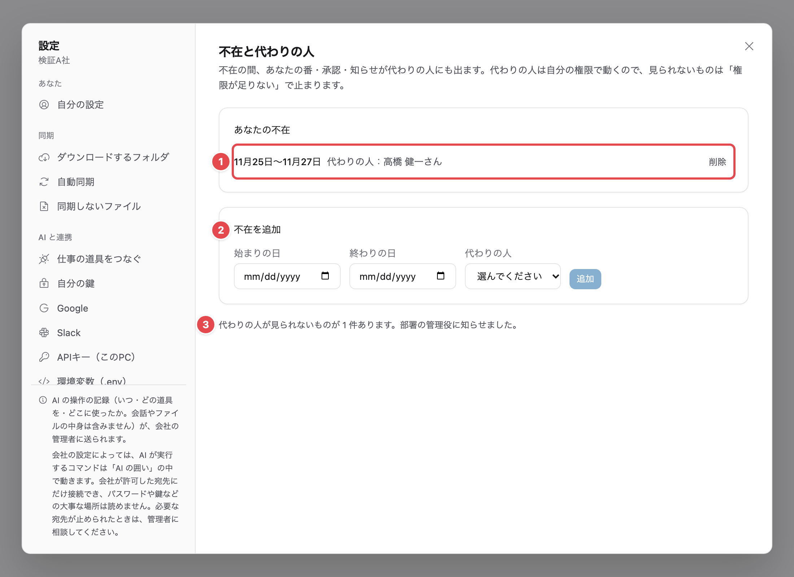
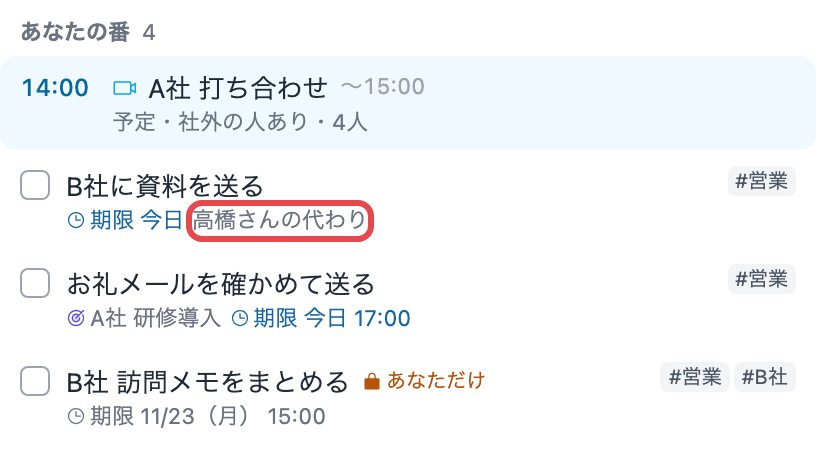

# 42章　休むとき：不在と代わりの人

## はじめに

前の章の最後に、こんな疑問が残りました。

「来週は3日間お休み。その間に届く頼まれごとや承認は、どうなるの？」

休む前に、Gmail で「不在の間は〇〇まで」と自動返信を出したことはありませんか？　ACB でも同じように、**休む日と、その間の代わりの人を決めておけます。** 20章でちらっと見た「代わりの人」を、この章で決めてみましょう。

### この章で分かること

- 休む日と代わりの人の入れ方
- 代わりの人に渡るもの、渡らないもの
- 代わりの人の側に見えるもの

---

## 休む日と代わりの人を入れる

タイトルバーの右はしのあなたの丸から［設定］を押し、左の一覧の［不在と代わりの人］を開きます。

1. ②の「不在を追加」で、**始まりの日・終わりの日・代わりの人** を選び、［追加］を押します。休みが1日だけなら、始まりと終わりを同じ日にします。
2. 入れた不在は、①のように「あなたの不在」に並びます。休みがなくなったら、行の右の［削除］で消せます。
3. 休みの間の日は、その行に「いま不在中」と出ます。

代わりの人には、ほかの人を選びます。**代わりの人も同じ期間に休みのときは、選べません。**「代わりの人もこの期間に不在です。別の人を選んでください」と出たら、ほかの人を選びましょう。

あなたが休みを入れ忘れたときは、管理者や部署の管理役が、代わりに入れることもあります。

---

## 代わりの人に渡るもの、渡らないもの

休みの間、**あなたの番・承認・知らせが、代わりの人にも出ます。** 頼まれごとや承認が、あなたの休み明けまで止まってしまうことはありません。

ただし、**代わりの人は、その人自身の権限のままで動きます。** あなたのメールや、「あなただけ」の記録（19章）、代わりの人が見られない非公開フォルダの中のものは、代わりの人には渡りません。休みを入れても、だれかが見られる範囲が広がることはありません。

代わりの人が見られないものがあるときは、追加したときに③のような知らせが出ます。

> 代わりの人が見られないものが 1 件あります。部署の管理役に知らせました。

この1件は、休みの間、代わりの人のところでは「権限が足りない」で止まります。部署の管理役が知っているので、必要ならそちらで手当てしてくれます。休む前に、自分で片づけておけるものは片づけておくと安心です。

---

## 代わりの人の側に見えるもの

代わりを頼まれた人のやることの一覧には、あなたの分が「〇〇さんの代わり」と出ます（20章）。

代わりの人が承認したときは、承認のカードや経緯に「〇〇さん（代わりに承認・本来は〇〇さん）」と残ります（23章）。あなたが戻ってきたときに、だれが代わりにしたのかが分かります。

いま、だれかの代わりを受け持っているときは、［不在と代わりの人］の上に「いま代わりを受け持っている人：〇〇さん（〜〇月〇日）」と出ます。

---

## 山田さんの場合

山田さんは、来週の水曜から金曜まで、研修でお休みです。［不在と代わりの人］で 11月25日〜11月27日を入れ、代わりの人に同じ営業部の高橋さんを選びました。

追加すると、「代わりの人が見られないものが 1 件あります」と出ました。山田さんは、「あなただけ」にしていた見積のやることだと気づきました。高橋さんには見えないので、休みの前の日に、自分で済ませておきました。休みの間に届いた A社の承認のお願いは、高橋さんが代わりに受けてくれました。

---

## まとめ

- 休むときは、設定の［不在と代わりの人］で、始まりの日・終わりの日・代わりの人を入れて［追加］を押します。
- 休みの間、あなたの番・承認・知らせが代わりの人にも出ます。
- 代わりの人は自分の権限のまま動きます。あなたのメールや、見られないものは渡りません。
- 代わりの人が承認すると「代わりに承認・本来は〇〇さん」と残ります。

## やってみよう

1. 設定の［不在と代わりの人］を開き、「不在を追加」の欄を見てみましょう。
2. 次の休みが決まっていたら、代わりの人と相談して、入れておきましょう。

---

休むときの備えもできました。

ところで、取引先の会社は「共有フォルダ」を使わずに ACB を始めたそうです。そういう会社では、何が違うのでしょうか？
