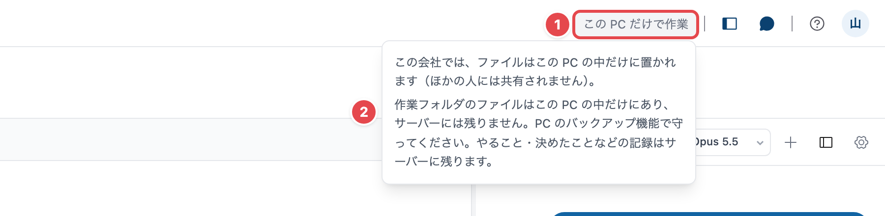
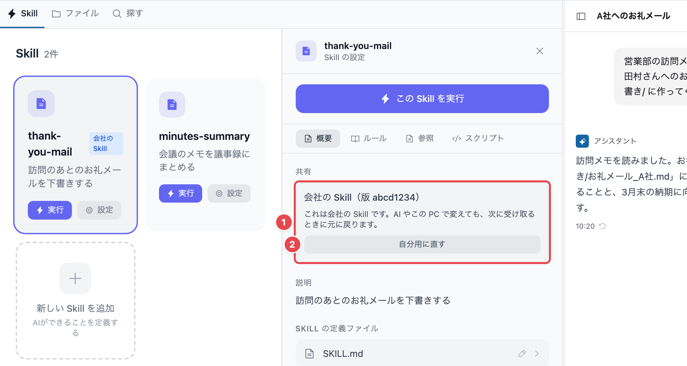

# 43章　共有フォルダのない会社では

## はじめに

前の章の最後に、こんな疑問が残りました。

「共有フォルダを使わずに ACB を始めた会社では、何が違うの？」

共有フォルダのない職場では、ファイルは自分の PC と、メールの添付だけ。そんな働き方をしてきた人も多いでしょう。

ACB は、会社ごとに「全社の共有フォルダを使う」か「使わない」かを選んで始めます。この取説の1〜40章は、共有フォルダを使う会社のお話でした。**共有フォルダを使わない会社では、ファイルはあなたの PC の中だけにあり、やること・決めたことなどの記録は会社のサーバーに残ります。** この章では、その違いだけをまとめます。

> **会社によって違います**
>
> この章のことは、共有フォルダを使わない会社だけのお話です。タイトルバーに「この PC だけで作業」と出ていなければ、読み飛ばしてかまいません。どちらにするかは会社が決めていて、あとから変えることはできません。

### この章で分かること

- 「この PC だけで作業」のしるし
- 共有フォルダのある会社と、違うこと・同じこと
- 「会社の Skill」の受け取り方と、自分用に直す方法

---

## 「この PC だけで作業」

共有フォルダを使わない会社では、タイトルバーの［サーバーと同期］のあたりに、①「この PC だけで作業」と出ます。押すと、②の説明が出ます。

②に書かれているとおりです。

- この会社では、ファイルはこの PC の中だけに置かれます（ほかの人には共有されません）。
- **作業フォルダのファイルはこの PC の中だけにあり、サーバーには残りません。PC のバックアップ機能で守ってください。**
- やること・決めたことなどの記録はサーバーに残ります。

PC が壊れると、作業フォルダのファイルも一緒になくなります。Mac の「Time Machine」など、PC のバックアップを必ず使いましょう。分からなければ、会社の情報システムの担当の人に聞いてください。

---

## 違うこと

共有フォルダがないので、同期にかかわるものがありません。

- タイトルバーに［サーバーと同期］がなく、あなたの丸にも［バックアップ履歴］がありません（11〜14章は読まなくて大丈夫です）。
- 設定に「ファイルと同期」の項目（この PC に置くフォルダ・自動同期）と、「詳しい設定」の「同期しないファイル」がありません。
- 作ったファイルは、**ほかの人には届きません。** 資料を渡すときは、Google ドライブなどで共有して、リンクを伝えます。
- 非公開フォルダはありません。［新しいフォルダ…］にも「公開範囲」は出ず、ファイルはこの PC の中だけに置かれる、という説明だけが出ます。
- ファイルの「前の版」（36章）はありません。

## 同じこと

ファイルの置き場所が違うだけで、ほかはふつうの会社と同じです。

- AI への相談（6〜8章）
- やること・プロジェクト・承認・受け箱・議事録・定期の仕事（17〜27章）。これらは会社のサーバーに残るので、ほかの人と一緒に使えます。
- Google・Slack とつなぐこと（28章〜）

---

## 会社の Skill

Skill（9章）は、共有フォルダの代わりに、会社のサーバーから「会社の Skill」として届きます。

1. ①のとおり、会社の Skill は、AI やこの PC で変えても、次に受け取るときに元に戻ります。会社の決まった手順を、みんなが同じように使うためです。
2. 自分の仕事に合わせて直したいときは、②［自分用に直す］を押します。確かめの文が出たら、もう一度［自分用に直す］を押します。それからは、**この PC の AI だけが、あなたの直した版を使います。** ほかの人の Skill は変わりません。

自分用に直している間は、「自分用に直している Skill」と出て、次のボタンが使えます。

- ［AI と一緒に直す］— 相談を開いて、AI と一緒に直せます。
- ［会社の版に戻す］— やめて、会社の版に戻します。あなたが直した版は控えとして残り、［控えを開く］で見られます。
- ［会社に出してほしいと頼む］— みんなにも使ってほしくなったら、会社に公開できる人に送ってお願いします（38章の「決めた人に頼む」と同じです）。公開されるまでは、この PC だけで使われます。Skill を会社に公開できる人（「Skill を直せる人」など）には、代わりに［会社に公開］が出ます。

自分用に直している間に会社の版が新しくなっても、［会社の版に戻す］を押すまで、あなたの PC には届きません。

---

## 山田さんの場合

> **物語の外のお話**
>
> 検証A社は共有フォルダを使う会社です。グループ会社の検証B社は、共有フォルダを使わずに ACB を始めました。山田さんが検証B社の仕事を手伝うときは、タイトルバーの会社の名前から検証B社に切り替えます（33章）。すると「この PC だけで作業」と出て、同期のボタンがありません。山田さんは、検証B社の人に資料を渡すときは、Google ドライブに置いてリンクを伝えるようにしています。

---

## まとめ

- 「この PC だけで作業」と出る会社では、ファイルはあなたの PC の中だけにあり、ほかの人に届きません。PC のバックアップを忘れずに。
- やること・決めたことなどの記録は、会社のサーバーに残ります。相談・やること・承認などは、ふつうの会社と同じです。
- 同期・非公開フォルダ・前の版はありません。資料は Google ドライブなどで渡します。
- Skill は「会社の Skill」として届きます。［自分用に直す］で、この PC だけの版にできます。

## やってみよう

1. タイトルバーに「この PC だけで作業」と出ているか確かめましょう。出ていれば押して、説明を読んでみましょう。
2. 出ている会社なら、PC のバックアップが動いているかを確かめましょう。

---

いろいろな設定が出てきました。設定の中で、自分が触るものはどれなのでしょうか？
