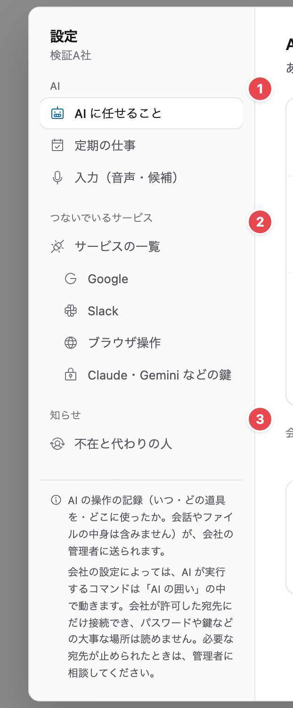
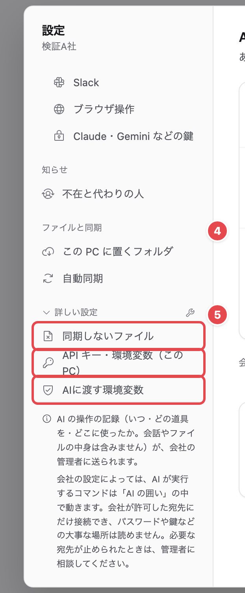
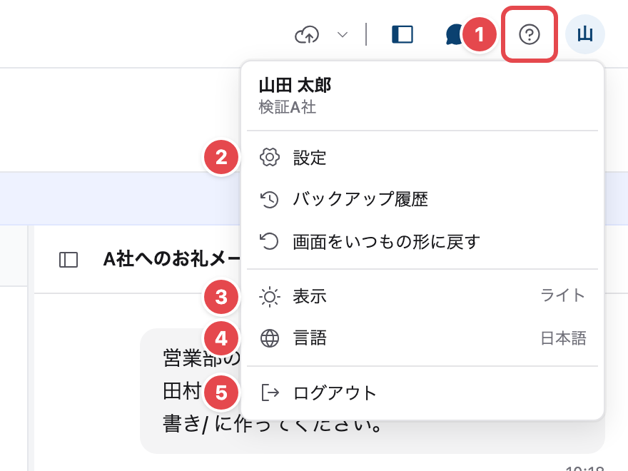
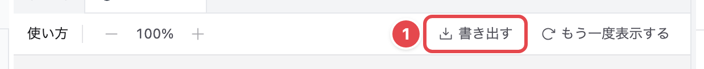

# 44章　設定の見取り図と、アカウント

## はじめに

前の章の最後に、こんな疑問が残りました。

「いろいろな設定が出てきた。設定の中で、自分が触るものはどれ？」

スマホの設定画面は、項目が多すぎて、触ったことのない所がたくさんありますよね。それでも困らないのは、自分に関係のある所だけを触っているからです。

ACB の設定も同じです。**触るのは、あなたの仕事にかかわる所だけ。分からない設定は、触らなくて大丈夫です。** この章では、設定の全体を一枚の見取り図にして、どの章に書いてあるかをまとめます。最後に、言葉・明るさ・ログアウトなど、タイトルバーの右はしにあるものも見ます。

### この章で分かること

- 設定の項目と、それぞれが書いてある章
- 触らなくてよい設定
- 言葉・明るさ・使い方・ログアウト

---

## 設定の見取り図

タイトルバーの右はしのあなたの丸を押し、［設定］を押すと、左に項目の一覧が出ます。項目は、**やりたいことごとに** 5つのまとまりに分かれています。一覧が長いときは、一覧の中でスクロールします。

| まとまり | 項目 | することと、書いてある章 |
|---|---|---|
| ①AI | ［AI に任せること］ | 「受信を読む」（25章）、「AI が自動で進める」（21章）、AI から定期の仕事を提案してもらう（26章）、今日のフォルダを置く部署と前の日のタブ（34章） |
| | ［定期の仕事］ | 受け取った定期の仕事（26章） |
| | ［入力（音声・候補）］ | 話して頼む・入力欄の候補（35章） |
| ②つないでいるサービス | ［サービスの一覧］ | Google や Slack とつないでいるか、つなぐと何ができるかを1か所で見る。［詳しく］でそれぞれの画面へ（28章） |
| | ［Google］［Slack］ | それぞれのサービスの細かい設定とやめ方（28章・29章） |
| | ［ブラウザ操作］ | 会社が許可したサイトを AI が操作する（32章）。会社が用意しているときだけ出ます |
| | ［Claude・Gemini などの鍵］ | AI が Skill の中で使う外部サービスの、あなたの鍵（28章） |
| ③知らせ | ［不在と代わりの人］ | 休む日と代わりの人（42章） |
| ④ファイルと同期 | ［この PC に置くフォルダ］ | PC に入れる部署やフォルダを選ぶ（3章・15章） |
| | ［自動同期］ | 自動で受け取る・自動で送る（5章） |
| ⑤詳しい設定 | ［同期しないファイル］ | 共有しないファイルを見る（39章）。変えるのは管理者 |
| | ［API キー・環境変数（この PC）］［AIに渡す環境変数］ | 会社の担当者が使う設定です |

⑤の［詳しい設定］は、ふだんは畳んであります。押すと開きます。

共有フォルダを使わない会社（43章）では、④ファイルと同期のまとまりと、［同期しないファイル］はありません。一覧のいちばん下には、AI の操作の記録と「AI の囲い」のお知らせがいつも出ています（41章）。

### 触らなくてよい設定

⑤の［API キー・環境変数（この PC）］［AIに渡す環境変数］は、Skill の道具などを動かすために、**会社の担当者が使う設定です。** 中に「.env の鍵をサーバーに移す」といったカードが出ることもあります。**分からない設定は、触らなくて大丈夫です。** 担当者から「ここに入れてください」と頼まれたときだけ、言われたとおりに使ってください。

入れた値は、保存したあとは画面に出ません（末尾の4文字だけ出ます）。保存しないまま閉じようとすると、「まだ保存していない変更があります」と聞かれます。

---

## タイトルバーの右はし

タイトルバーの右はしには、［使い方］（?）と、あなたの名前の頭文字が入った丸があります。丸を押すと、あなたの名前と会社、アプリ全体にかかわる項目が出ます。

1. ①［使い方］— この取説を、アプリの真ん中に開きます。
2. ②［設定］— この章の見取り図の設定です。
3. ③［表示］— 押すたびに、画面の明るい色（ライト）と暗い色（ダーク）が切り替わります。
4. ④［言語］— 押すたびに、画面の言葉が日本語と英語で切り替わります。
5. ⑤［ログアウト］— アプリからログアウトします。開いているタブは、先に保存されます。ほかの人に PC を貸すときや、別のアカウントで入り直すときに使います。一番下に、ほかと離して置いてあります。

丸のメニューは、Esc か、メニューの外を押すと閉じます。

### 取説を手元に保存する

［使い方］で開いた取説の上には、操作のボタンが並んでいます。

①［書き出す］を押すと、取説のページと写真を、あなたが選んだフォルダに保存できます（会社のフォルダには書き出せません）。印刷したいとき、インターネットにつながらない所で読みたいときに使います。

アプリにサインインできないときも、取説はサーバーのアドレスの `/manual/` で読めます（目次のページの「困ったときは」）。

---

## 山田さんの場合

山田さんは、この章の見取り図を見ながら、自分の設定を一つずつ見直しました。触ったのは、①の［AI に任せること］と［入力（音声・候補）］だけです。⑤［詳しい設定］の中は、何も入っていなくても困らないので、そのままにしました。

夜に作業するときは、③［表示］で画面を暗くしています。

---

## まとめ

- 設定は、AI・つないでいるサービス・知らせ・ファイルと同期・詳しい設定の5つのまとまりです。どの項目も、この取説のどこかの章に書いてあります。
- ［詳しい設定］の中の［API キー・環境変数（この PC）］［AIに渡す環境変数］は会社の担当者が使う設定です。分からない設定は触らなくて大丈夫です。
- タイトルバーの右はしの［使い方］で取説を開きます。あなたの丸から、明るさ（［表示］）と言葉（［言語］）を切り替え、［ログアウト］でログアウトします。
- ［書き出す］で、取説を手元に保存できます。

## やってみよう

1. ［設定］を開き、5つのまとまりを上から順に見てみましょう。
2. ［使い方］を開き、［書き出す］で取説を手元に保存してみましょう。

---

これで、この取説はおしまいです。

困ったときは、慌てずに、出ている画面をそのまま管理者に見せてください。どの画面に、何と書いてあるか。それが分かれば、たいていのことはすぐに解決します。
