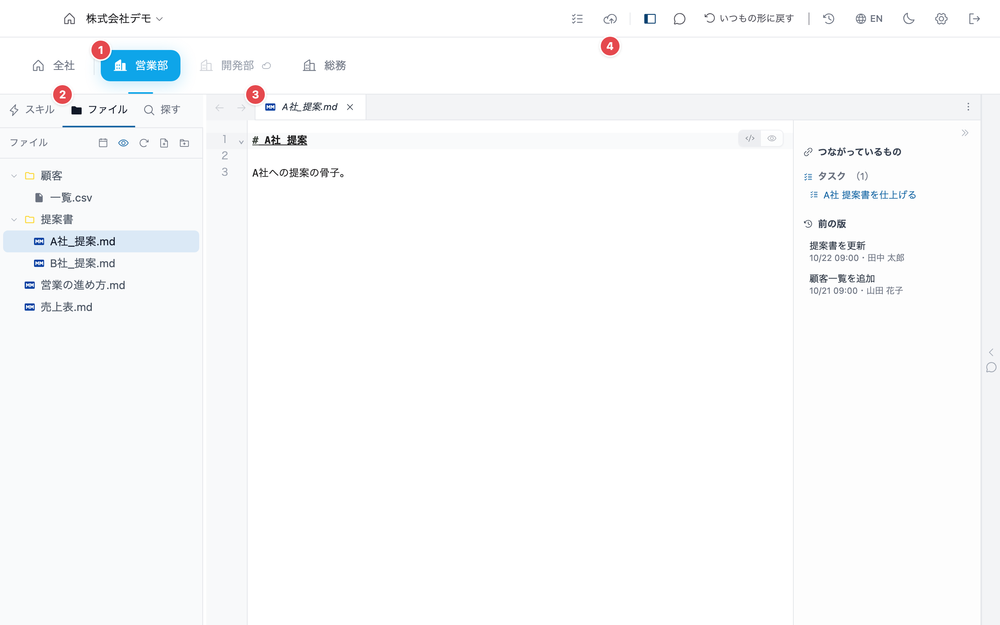
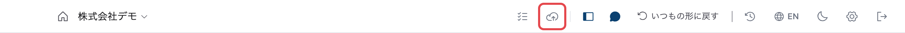

# 画面の見かた（見本）

アプリを開くと、次の画面になります。

1. **部署** — 見たい部署を選びます。
2. **ファイル** — 部署のファイルとフォルダの一覧です。
3. **開いているファイル** — 一覧で選んだファイルの中身がここに出ます。
4. **同期ボタン** — 自分の変更を会社のみんなに届け、みんなの変更を受け取ります。

## 同期する

右上の雲のボタンを押すと同期します。

